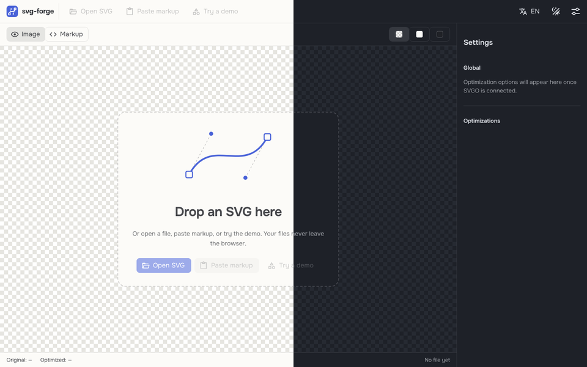

# svg-forge

[Русская версия](README.ru.md)

An SVG optimizer that runs entirely in the browser. Drop in an SVG, tune the [SVGO](https://github.com/svg/svgo) options, compare the result and download it. Files are processed on your device and never uploaded anywhere.

Inspired by Jake Archibald's [SVGOMG](https://github.com/jakearchibald/svgomg), written from scratch with Vue 3 and extended with features for front-end work.



> Work in progress. The layout, themes and localization are in place; the optimizer is being wired up next. See the [roadmap](#roadmap).

## Features

**Ready**

- Light, dark and system themes, tuned for long sessions: no pure white or black, softened text contrast
- English and Russian interface; the browser language is picked on first visit
- Preview background independent of the theme: checkerboard, light or dark
- Responsive layout down to phone width
- Strict Content-Security-Policy on deploy

**Planned**

- All SVGO options with live preview and size statistics (raw and gzip)
- Markup view with syntax highlighting
- Before / after comparison slider
- Export as a Vue component, data URI or CSS background
- Batch processing with zip download
- SVG sprite generation
- Saved option presets
- Offline support (PWA)

## Security

SVG files can contain scripts and event handlers. svg-forge never injects user SVG into the page DOM:

- previews are rendered through ``, where scripts never run and external resources never load;
- `v-html` is forbidden by the lint config;
- the deployed site sends a strict CSP that only allows scripts from its own origin.

## Tech stack

| Area      | Choice                                                |
| --------- | ----------------------------------------------------- |
| Framework | Vue 3 (Composition API, `<script setup>`), TypeScript |
| Build     | Vite                                                  |
| UI        | Vuetify 4, Material Design Icons as SVG paths         |
| State     | Pinia, VueUse                                         |
| i18n      | vue-i18n, connected to Vuetify through its adapter    |
| Fonts     | Onest and JetBrains Mono, self-hosted via Fontsource  |
| Quality   | ESLint (flat config), Prettier, vue-tsc               |
| Hosting   | Vercel                                                |

## Getting started

Requires Node.js 20.19 or newer.

```bash
npm install
npm run dev
```

| Script               | What it does                        |
| -------------------- | ----------------------------------- |
| `npm run dev`        | Start the dev server                |
| `npm run build`      | Type-check and build for production |
| `npm run preview`    | Serve the production build locally  |
| `npm run lint`       | Lint and auto-fix                   |
| `npm run format`     | Format `src/` with Prettier         |
| `npm run type-check` | Run vue-tsc                         |

## Project structure

```text
src/
  components/    UI components (header, preview stage, settings panel…)
  composables/   theme and language sync
  i18n/          vue-i18n setup and EN/RU messages
  plugins/       Vuetify setup
  stores/        Pinia stores: persisted settings, transient UI state
  theme/         light and dark palettes
  icons.ts       every icon the app uses, in one place
```

## Roadmap

1. Load SVG: open file, paste markup, drag and drop, demo file
2. SVGO in a Web Worker, global options and plugin toggles
3. Markup view (CodeMirror), size statistics, download and copy
4. Comparison slider, presets
5. Export to Vue component, data URI, CSS
6. Batch processing and sprites
7. PWA

## License

Not chosen yet.
