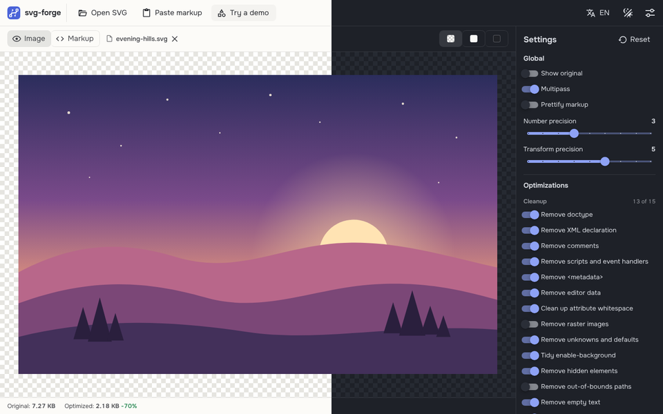

# svg-forge

[English version](README.md)

[](https://github.com/it2konst/svg-forge/actions/workflows/ci.yml)

**Живое демо: [svg-forge-two.vercel.app](https://svg-forge-two.vercel.app)**

Оптимизатор SVG, который работает полностью в браузере. Перетащите SVG, настройте параметры [SVGO](https://github.com/svg/svgo), сравните результат и скачайте его. Файлы обрабатываются на вашем устройстве и никуда не загружаются.

Проект вдохновлён [SVGOMG](https://github.com/jakearchibald/svgomg) Джейка Арчибальда, написан с нуля на Vue 3 и дополнен функциями для фронтенд-разработки.



> Все шаги [плана](#план) готовы: одиночные файлы и пакеты, экспорт в код, zip или SVG-спрайт, установка как приложение и работа офлайн. Идеи и сообщения об ошибках приветствуются.

## Возможности

- SVGO 4 работает в Web Worker, интерфейс не зависает; результат обновляется сразу при изменении настроек
- Общие параметры (несколько проходов, точность чисел и трансформаций, форматирование) и переключатели 47 плагинов SVGO в пяти группах, сохраняются между визитами
- Размер после оптимизации и процент изменения в строке статуса
- Слайдер «до / после»: можно тянуть, кликнуть в нужное место или двигать стрелками
- «Показать исходный», чтобы переключить весь вид на оригинал
- Экспорт в код: компонент Vue 3 (пропсы `size` и `title`, опционально один цвет через `currentColor`), CSS-класс (фон или перекрашиваемая маска) или data URI (URL-кодирование или base64)
- Пресеты: четыре встроенных («SVGO по умолчанию», «Сохранить структуру», «Максимальное сжатие», «Инлайн-иконки») и свои, сохраняются в браузере
- Скрипты и обработчики событий по умолчанию удаляются из результата
- Открыть SVG с диска (или Ctrl+O), вставить код в диалоге или через Ctrl+V в любом месте, перетащить файл в окно
- Пакетная обработка: откройте или перетащите несколько файлов, они оптимизируются параллельно в нескольких Web Worker с одними настройками; скачайте каждый или все сразу в zip, откройте любой в редакторе
- SVG-спрайт из пакета: каждый файл становится `<symbol>`, внутренние ID получают префикс, поэтому иконки не конфликтуют; отдельным `sprite.svg` или внутри HTML, с превью, нарисованным из самого спрайта
- Пример-файл, чтобы попробовать приложение без своего SVG
- Работает инлайн-SVG, скопированный из HTML: недостающие `xmlns` и `xmlns:xlink` добавляются автоматически
- Понятные переведённые ошибки: пустой ввод, не-SVG файл, сломанный код, файл больше 10 МБ
- Безопасное превью
- Просмотр кода с подсветкой, номерами строк и поиском (CodeMirror 6, загружается по требованию)
- Скачать результат (или Ctrl+S) либо скопировать код
- Сравнение размеров после gzip через встроенный в браузер CompressionStream
- Светлая, тёмная и системная темы, рассчитанные на долгую работу: без чистого белого и чёрного, с мягким контрастом текста
- Интерфейс на английском и русском; при первом визите выбирается язык браузера
- Фон превью не зависит от темы: шахматный, светлый или тёмный
- Адаптивная вёрстка вплоть до ширины телефона
- Строгая Content-Security-Policy на деплое
- Работает офлайн после первого визита: service worker кэширует всё приложение, включая воркер SVGO, просмотр кода и шрифты
- Ставится как отдельное приложение (Chrome, Edge, Android, Safari на iOS и macOS); после установки появляется в «Открыть с помощью» для .svg файлов в Chrome и Edge на компьютере
- Новая версия не навязывается: приложение предлагает «Обновить» и перезагружается только с вашего согласия
- Превью ссылки: ссылка на проект разворачивается в карточку в мессенджерах и соцсетях

## Безопасность

SVG-файлы могут содержать скрипты и обработчики событий. svg-forge никогда не вставляет пользовательский SVG в DOM страницы:

- превью показывается через ``, где скрипты не выполняются, а внешние ресурсы не загружаются;
- `v-html` запрещён правилами линтера;
- входящий код сначала разбирается через `DOMParser` в XML-режиме, который никогда не выполняет скрипты;
- задеплоенный сайт отдаёт строгую CSP, разрешающую скрипты только со своего домена.

## Стек

| Область       | Выбор                                                 |
| ------------- | ----------------------------------------------------- |
| Фреймворк     | Vue 3 (Composition API, `<script setup>`), TypeScript |
| Сборка        | Vite                                                  |
| UI            | Vuetify 4, иконки Material Design как SVG-пути        |
| Состояние     | Pinia, VueUse                                         |
| i18n          | vue-i18n, связанный с Vuetify через адаптер           |
| Шрифты        | Onest и JetBrains Mono, локально через Fontsource     |
| Качество кода | ESLint (flat config), Prettier, vue-tsc               |
| Тесты         | Vitest с jsdom, CI на GitHub Actions                  |
| Оптимизатор   | SVGO 4 в Web Worker, Comlink                          |
| Офлайн        | vite-plugin-pwa (Workbox), Web App Manifest           |
| Просмотр кода | CodeMirror 6                                          |
| Хостинг       | Vercel                                                |

## Запуск

Нужен Node.js 20.19 или новее.

```bash
npm install
npm run dev
```

| Скрипт               | Что делает                                 |
| -------------------- | ------------------------------------------ |
| `npm run dev`        | Запускает dev-сервер                       |
| `npm run build`      | Проверяет типы и собирает продакшен-сборку |
| `npm run preview`    | Отдаёт продакшен-сборку локально           |
| `npm run lint`       | Проверяет код и исправляет что может       |
| `npm run format`     | Форматирует `src/` через Prettier          |
| `npm run type-check` | Запускает vue-tsc                          |
| `npm test`           | Запускает юнит-тесты                       |
| `npm run test:watch` | Перезапускает тесты при каждом изменении   |
| `npm run coverage`   | Тесты с отчётом о покрытии                 |

## Тесты

Юнит-тесты работают на Vitest в jsdom и запускаются на каждый push в GitHub Actions. Они покрывают места, где тихая ошибка обошлась бы дороже всего:

- проверку входного SVG: что считается SVG, сломанный код, лимит размера и то, что при разборе не выполняются скрипты
- каталог плагинов против установленной версии SVGO: если обновление SVGO переименует или переставит плагины, сборка упадёт
- весь конвейер: наши настройки через `svgo/browser` на реальных файлах, для каждого пресета
- экспорт: сгенерированные Vue-компоненты компилируются настоящим компилятором Vue и рендерятся; data URI и CSS декодируются обратно
- работу с воркерами (отмена, таймаут, восстановление) и очередь пакета, на поддельных воркерах
- спрайты: ID и все виды ссылок на них переименовываются, поэтому иконки с одинаковым ID градиента сохраняют свои цвета

## Структура

```text
src/
  components/    UI-компоненты (шапка, область превью, панель настроек…)
  composables/   загрузка SVG (файл, вставка, drop, пример, «Открыть с помощью»), ошибки, PWA, синхронизация темы и языка
  i18n/          настройка vue-i18n и сообщения EN/RU
  editor/        настройка CodeMirror для просмотра кода
  export/        генераторы Vue-компонента, CSS, data URI, спрайта и zip
  optimizer/     воркер SVGO, слоты воркеров и очередь, каталог плагинов, сборка конфига SVGO
  plugins/       настройка Vuetify
  stores/        Pinia: текущий документ, пакет, оптимизатор, пресеты, уведомления, настройки, UI
  utils/         проверка и нормализация SVG, форматирование размера
  theme/         светлая и тёмная палитры
  icons.ts       все иконки приложения в одном месте
```

## План

1. ~~Загрузка SVG: открыть файл, вставить код, drag and drop, пример~~ ✓
2. ~~SVGO в Web Worker, общие параметры и переключатели плагинов~~ ✓
3. ~~Просмотр кода (CodeMirror), статистика размера, скачивание и копирование~~ ✓
4. ~~Слайдер сравнения, пресеты~~ ✓
5. ~~Экспорт в Vue-компонент, data URI, CSS~~ ✓
6. ~~Пакетная обработка, тесты и CI, SVG-спрайты~~ ✓
7. ~~PWA: офлайн, установка, открытие .svg файлов приложением, превью ссылки~~ ✓

## Автор

Сделал [it2konst](https://github.com/it2konst). Ошибки и предложения можно оставить в [GitHub Issues](https://github.com/it2konst/svg-forge/issues).

## Лицензия

[MIT](LICENSE)
